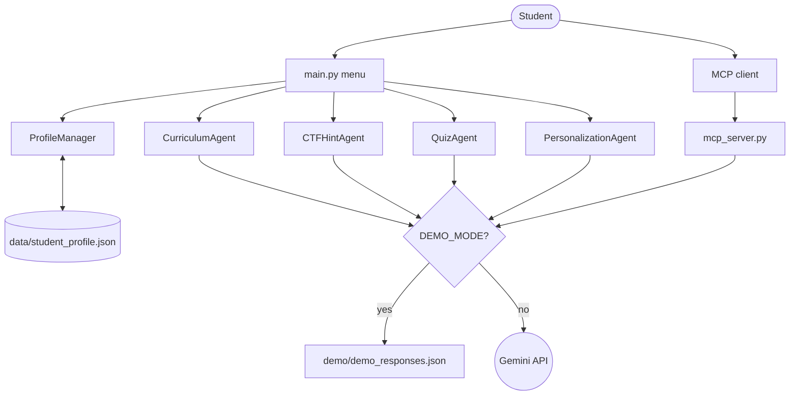

# SecureLearn Agent

A command-line study assistant for cybersecurity students. It builds learning paths, gives progressive CTF hints without revealing the flag, runs short quizzes, and suggests what to study next from your quiz history. It also exposes two of these as local MCP tools.

Content comes from the Gemini API in live mode, or from canned responses in demo mode.

## Try it (no API key)

```bash
pip install -r requirements.txt
cp .env.example .env        # DEMO_MODE=true is the default
python main.py
```

Demo mode replays the sample responses in `demo/demo_responses.json` through the same menu, profile tracking and file saving as live mode. Responses do not change with your input, so the quiz and learning path are always the sample ones.

## Live mode

Set `DEMO_MODE=false` and `GEMINI_API_KEY` in `.env`. The model name defaults to `gemini-2.5-flash` and can be changed with `GEMINI_MODEL`, because Gemini model names are retired from time to time.

Live mode uses the current `google-genai` SDK. It has not been run end to end in automated tests, because the tests use a fake client and no network.

## How it works



- **CurriculumAgent**: Markdown learning path for a topic.
- **CTFHintAgent**: three progressive hints. The prompt tells the model not to give the flag, but a model can still slip, so treat hints as guidance.
- **QuizAgent**: multiple-choice questions parsed from JSON. Malformed questions are dropped.
- **PersonalizationAgent**: recommends one topic using weak areas (quiz scores under 70%) and topics studied.
- **ProfileManager**: JSON file with topics studied, quiz scores, weak areas and a daily streak. Missing or corrupt files fall back to defaults.

These four are small prompt wrappers called by the menu, not autonomous agents.

## MCP server

```bash
python mcp_server.py   # http://127.0.0.1:8080, localhost only
```

Tools: `get_topic_resources(topic, difficulty_level)` and `generate_quiz(topic, num_questions)`. Topics are limited to 100 characters, and quizzes to 1 to 10 questions. The server has no authentication, so it binds to localhost and should stay there: in live mode every call spends your API quota.

## Safety notes

- `.env`, your profile and generated learning paths are git-ignored.
- Learning-path file names are sanitized, so a topic like `../../x` cannot write outside `learning_paths/`.
- Topics are length-limited and trimmed before they reach a prompt. This reduces, but does not remove, prompt-injection risk.

## Tests

```bash
pip install -r requirements-dev.txt
python -m pytest -q
```

27 tests cover helpers, all four agents, the profile manager, the CLI flow and the MCP functions.

## Limits and future work

- Quality of live output depends on the model and is not checked automatically.
- Single local user; no accounts.
- Ideas: TryHackMe and Hack The Box context, a web interface, a link with AdaptShield.

## License

MIT, see `LICENSE`.
